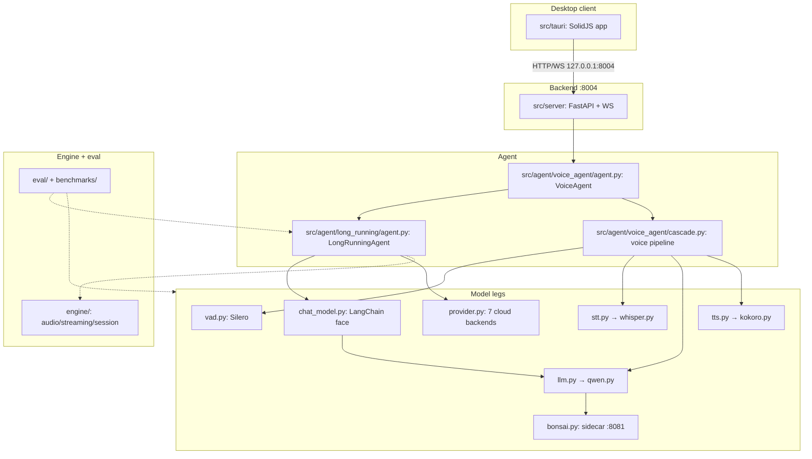
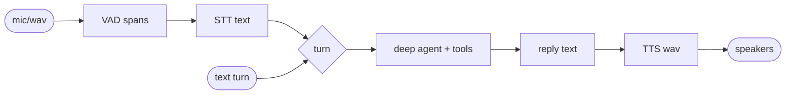
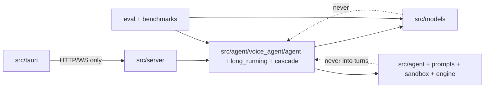

# ARCHITECTURE — VoiceRT voice-pipeline (single file)

System design, component contracts, and dependency rules. DOCUMENTS
the current code — nothing here is a proposal unless labeled
**PROPOSAL**. No application code was modified to write this.

## 1. System purpose and scope

VoiceRT is a local-first voice agent: microphone audio in, spoken
audio out, with a tool-using agent in the middle. One 4GB laptop GPU
runs the whole stack (measured: 551ms fast-path turn end-to-end).
Cloud chat models are supported as backends, but the default path is
fully local: no audio or text leaves the machine.

In scope: entry points, server, agent harness, voice pipeline, model
legs, engine helpers, eval/benchmark harnesses, desktop client.
Out of scope: weight training, dataset curation, the Tauri Rust
shell internals.

## 2. Component diagram

## 3. Data flow

- Voice: `CascadePipeline` (`src/agent/voice_agent/cascade.py`) runs VAD → STT →
  harness text turn → TTS; per-leg node timings ride `AgentEvent`s.
- Text: `LongRunningAgent.__call__(text, sid) -> str`
  (`src/agent/long_running/agent.py`) delegates to `TurnRunner` → scheduler →
  worker ensure → `TurnBox` → `builder` → graph stream. Session load/write-back
  lives in `SessionMiddleware`; memory and turn context are middleware too.
- Cloud backends skip `LlmModel`: the harness holds a stock
  LangChain chat model from `provider.ChatModel.get` instead.
- Sessions persist as `sessions/*.json` (default dir `~/.voicert`);
  RAM windows are the live source of truth.

## 4. External dependencies, model runtimes, hardware

| Area | Verified fact |
|---|---|
| Runtime | Python 3.13.12, torch 2.6.0+cu124, pydantic 2.13.5 |
| Agent framework | deepagents 0.7.16 over langgraph 1.2.11, langchain-core 1.6.10 |
| Server | FastAPI 0.141.1 + uvicorn, one backend on `:8004` (`src/server/__main__.py`, 8 routers) |
| Desktop | Tauri + SolidJS 1.9.12, HTTP/WS to `127.0.0.1:8004`, no Tauri commands (pure fetch client) |
| Local legs | Silero VAD (CPU ONNX), Whisper-base fused, Qwen3-0.6B fused Triton, Kokoro-82M, Bonsai 2 27B GGUF via Prism-fork llama-server on `:8081` |
| Cloud legs | groq/gemini/anthropic/openai/openrouter/deepseek/openai_compat via langchain provider packages + `OPENAI_COMPAT_*` env |
| Secrets | explicit arg → env → OS keychain (`src/agent/keystore.py`) → repo `.env`; `/keys` bridge routes |
| Hardware bound | 4GB target; preflight refuses doomed warms (`LEG_VRAM_MB qwen=2000`, STT/TTS 800 each, VAD 100 RAM — `src/models/runtime/guard.py`); Bonsai `-ngl` auto from free VRAM |
| Repro | `PYTHONPATH=.` required (kernels at `src.models.triton_kernels`) |

## 5. Component contracts

| Component | Responsibility | Inputs → Outputs | Errors |
|---|---|---|---|
| `src/server` (`__main__`, `__init__`, `state`, `routes/*`, `console_cli`) | process-wide agent, HTTP+WS API, model switching | HTTP/WS → JSON/events; `switch_model(name)` | error dicts, never raises (`switch_model`); refusal latches |
| `VoiceAgent` (`src/agent/voice_agent/agent.py`) | text + voice entries over harness + cascade | audio/text → reply/events | worker-down text, never raises turns |
| `LongRunningAgent` (`src/agent/long_running/agent.py`) | model legs, stores, public entries; turn work in `TurnRunner` + services | text → reply str / events | `ValueError` empty; down-notice; `TurnBoxError` inside box only |
| `CascadePipeline` (`src/agent/voice_agent/cascade.py`) | VAD/STT/LLM/TTS voice turns | wav → wav + node timings | leg failures as events |
| `LlmModel` (`src/models/llm.py`) | local LLM facade, template extraction | msgs → `LlmResult(text, tool_calls, ttft, tps)` | `SystemExit` on cloud backend / sick driver |
| `BonsaiLlamaCpp/BonsaiChatModel` (`src/models/bonsai.py`) | 27B sidecar + LC face | msgs → text / `AIMessage`+calls | transport errors raise; unhealthy → abort |
| `Vad/Stt/TtsModel` | speech legs | audio ↔ text/spans | `ValueError` empty audio; never-hang warm |
| `ChatModel` (`src/models/provider.py`) | 7 cloud backends + key/model save | ids → LC chat model | `SystemExit` missing key; `ValueError` unknown backend |
| `LocalChatModel` (`src/models/chat_model.py`) | LC face, verbatim tool calls | LC msgs → `AIMessage` | never raises on model content |
| `engine/` | audio resample, streaming, engine sessions | wav/tokens → wav/tokens | thin helpers, caller-handled |
| `eval/` + `benchmarks/` | GAIA/BFCL + perf harnesses | configs → results JSON | smoke flags only truncate; full runs default |
| Tauri app (`src/tauri/src`) | UI, keys via `/keys`, `/model` switching | user → HTTP/WS | bridge-down notes, never crashes turns |

State ownership: sessions own transcripts (`JsonSessionMemory`);
legs own weights/VRAM; `TurnBox` owns cwd/containers per turn;
`_current_model` (server) owns the active-profile label; `TurnScheduler`
owns per-session serialization; `SessionMiddleware` owns transcript
load/write-back. Concurrency: one turn per session at a
time (`asyncio.Lock` + contender queue); one GPU process at a time.

## 6. Verified facts vs assumptions and unknowns

Verified (read the file): entry command and `:8004` single backend;
8 routers; Tauri pure-fetch client; all leg classes and backends;
guard VRAM table; keychain→`.env` chain; groq default with qwen
fallback (`src/server/state.py`); front-model removal (no
`front_llm`/`delegate_cfg` in code).

Assumptions (believed, not re-measured here): 551ms E2E and per-leg
RTFs from `docs/benchmarks.md`; Bonsai 1.4 tok/s from the last sidecar
run; 4GB-box fit of the default stack.

Unknowns: full `eval/` cost on this box; sidecar `:8081` canonical
ownership (spawned by warm vs externally managed); behavior with two
concurrent voice sessions on 4GB VRAM.

## 7. Flagged architectural problems (not fixed)

Legacy docs (`docs/architecture.md`, `docs/ARCHITECTURE.md`) are labeled
historical; the root `ARCHITECTURE.md` is current.

1. **Orphaned modules**: `src/agent/delegate.py`,
   `src/agent/prompts/delegate.py`, `configs/delegate.yaml` have no
   importers since the front removal.
2. **Two provider homes**: `src/agent/cloud_models.py` was deleted in
   favor of `src/models/provider.py` (uncommitted at write time) —
   until that lands, both exist.

## 8. Dependency rules

1. UI → server over HTTP/WS only. No imports, no shared code.
2. Server → agent harness + legs for switching only; turns go
   through `VoiceAgent` entries, never leg internals.
3. Harness imports (top of file only): legs, tool assembly,
   middleware, stores, prompts, sandbox, `deepagents`/`langchain`.
4. Legs never import the harness, the server, or each other
   (except documented leg→weights files, e.g. `stt.py` →
   `whisper.py`).
5. `src/agent/*` never imports `src/server/*`.
6. Prompts are data: code may import prompts, prompts import nothing.
7. Eval/benchmarks may import anything but nothing imports them.
8. Secrets flow one way: callers → `keystore`/`.env`; keys never
   appear in logs, events, or results JSON.

Dependency inversion: legs and stores sit behind facades the
harness constructs (`LlmModel`, `JsonSessionMemory`,
`create_deep_agent`); callers depend on the facade, never the
engine file. Injection: model/backend/paths arrive via frozen
pydantic configs (`LlmConfig`, `LongRunningConfig`), never globals.

### Enforcement (PROPOSAL — not yet implemented)

Existing tooling suffices, no new dependencies: a `bash`+`rg`
boundary script (stdlib only) run beside the evals. Required checks,
each failing the run on violation:

- `rg 'from src\.server import' src/models/` → must be empty (rule 4).
- `rg 'from src\.agent\.(voice_agent|long_running|sandbox) import' src/models/`
  → empty; models import only data/prompt helpers from `src.agent`.
- `rg '^ +(from|import) ' src/agent/long_running/agent.py src/agent/voice_agent/agent.py` →
  empty (all imports top-level, `AGENTS.md: Imports`).
- `rg 'import src\.agent\.chat_model|src/agent/chat_model' src/`
  → empty (moved to `src/models/chat_model.py`).
- `python -m py_compile` over `src/` (import-time cycles fail loud).
- `tsc --noEmit` in `src/tauri` (UI contract gate).

Unit/integration requirements: every new leg ships a no-weights
pure-function test (extraction, budgets, guards) plus a results-JSON
smoke (`benchmarks/results/<name>_<tag>_<ts>.json`) before its numbers
enter `docs/benchmarks.md`.

## Files inspected

`src/server/__main__.py`, `src/server/__init__.py`,
`src/server/state.py`, `src/agent/long_running/agent.py`, `src/agent/voice_agent/agent.py`,
`src/agent/voice_agent/cascade.py`, `src/models/llm.py`, `src/models/bonsai.py`,
`src/models/provider.py`, `src/models/chat_model.py`,
`src/models/vad.py`, `src/models/stt.py`, `src/models/tts.py`,
`src/models/runtime/guard.py`, `src/agent/keystore.py`,
`src/tauri/package.json`, `src/tauri/src/api/client.ts`,
`docs/architecture/README.md`, `docs/architecture/01-agent.md`,
`README.md`, `AGENTS.md`.
