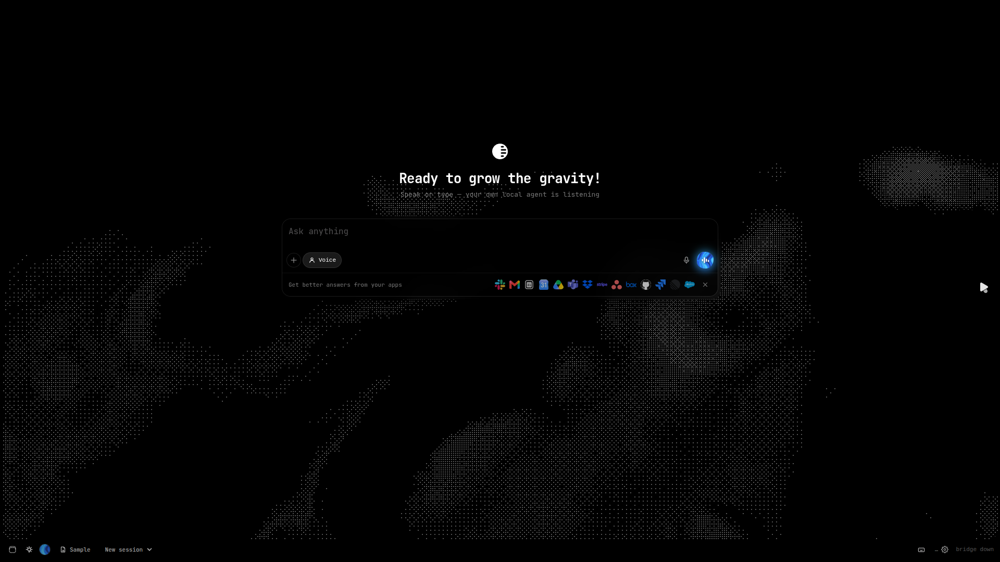

---



<p align="center">
  <a href="https://se00n00.github.io/Personal-Blog/article/d04e66e7-caba-4155-bd6a">
    
  </a>
  <a href="https://x.com/Se00n001">
    
  </a>
  <a href="docs/README.md">
    
  </a>
  <a href="docs/guide.md">
    
  </a>
</p>

___

VoiceRT is a real-time voice agent for one small GPU — mic in, VAD → STT → LLM → TTS out in ≈0.5–1.0 s, local or cloud.
One planner runs the agentic loop, handing steps to tag-narrowed specialists on the same model.
Sessions persist, memory compounds, and the local path fits a 4GB card.
A Tauri desktop client, FastAPI backend, and XDG-managed local state keep the loop on your machine.

---

### Index

| # | Part | |
|---|---|---|
| — | [Architecture](docs/architecture/README.md) | diagrams, legs, engine, kernels |
| 00 | [ARCHITECTURE](ARCHITECTURE.md) | system design, contracts, dependency rules |
| 01 | [Agent](docs/architecture/01-agent.md) | warm order, turn loop, budgets |
| 02 | [Tools](docs/architecture/02-tools.md) | ops, parsers, router, deny policy |
| 03 | [Memory](docs/architecture/03-memory.md) | L1 window, L2 episodes, L3 facts |
| 04 | [Sessions](docs/architecture/04-sessions.md) | identity, persistence, resume |
| 05 | [Models](docs/architecture/05-models.md) | four legs, backends, streaming, VRAM |
| 06 | [Processes](docs/architecture/06-processes.md) | backend endpoints, startup-warm trap |
| 07 | [Inference](docs/architecture/07-inference.md) | retired custom runtime |
| 08 | [TUI](docs/architecture/08-tui.md) | Tauri client, commands, voice mode |

---

```
─── 01 ~ 1 / HIGH LEVEL ──────────────────────────────────────────────────────────────────────────────

        ┌──────────────┐   ┌─────────────────────┐   ┌───────────────────┐   ┌───────────────┐
  wav |>  | Silero VAD | |> | Tiny Whisper (STT) | |> | Qwen3-0.6B (LLM) | |> | Kokoro (TTS) | |> wav
        └──────────────┘   └─────────────────────┘   └───────────────────┘   └───────────────┘


─── 01 ~ 2 / TWO BRAINS ──────────────────────────────────────────────────────────────────────

  text ──▶ front Qwen3-0.6B  ── one yes/no, NO tools, 6 tokens
            │
            ├── NO ──▶ front writes reply ──▶ TTS     (≈0.3s, 27B never loads)
            │
            └── YES ─▶ worker Bonsai 27B ──▶ full harness ──▶ TTS

  unparseable answer ──▶ YES        failure is asymmetric: silence is never "done"
  backstop regex ──▶ force YES      0.6B narration is the bug to never ship

─── 01 ~ 3 / CONTEXT BUDGET ──────────────────────────────────────────────────────────────────

  BUDGET 16K - pack_prompt cuts obs → hist, never system/facts
  ┌────────────┬───────────┬──────────────────────┬───────────────┬────────────┐
  │ system +   │ tool      │ history              │ observations  │ reserve    │
  │ preamble   │ specs     │ elastic - newest-    │ 1500 → 500    │ 256 / 512  │
  │ ~2.5K      │ ~1K       │ first fill           │ → drop        │ floor      │
  │ FIXED      │ FIXED     │ ELASTIC              │ ELASTIC       │ FIXED      │
  └────────────┴───────────┴──────────────────────┴───────────────┴────────────┘
  count: /tokenize exact, else chars/3.5 - per-backend rows in budget.py:BUDGETS

─── 02 / TOOLS ───────────────────────────────────────────────────────────────────────────────

  30 ops (src/agent/tool_router.py:ALLOWED_OPS)
  shell/files: bash python_exec read write edit list glob grep move delete
  web/gui: webfetch websearch open_url browser_* screenshot click type_text …
  meta: task question skill done write_todos

  model text ──▶ 5 parsers, tried in order ──▶ action ──▶ 2 gates ──▶ run
                gemma → functiongemma         ┌──────────────┐
                → toolcall-dict → terminal    │ DENY  fork   │
                → xml                         │ bomb rm -rf /│
                                             ├──────────────┤
                edit = ANCHORED replace      │ CONFIRM sudo │
                fails if anchor missing      │ rm docker ssh│
                                             └──────────────┘
  router: bge-small-en-v1.5 embeds the request, top-k=3 ops + deps, ContextVar → prompt
  MCP: python_exec / fetch / web_search over stdio, merged into the same op set

─── 03 / MEMORY ──────────────────────────────────────────────────────────────────────────────

  L1 evict -> L2 store - L2/L3 recall -> prompt (every turn)
  ┌────────────────────┐
  │ L1 WORKING         │
  │ sessions/*.json    │
  │ window+tok-TTL-LRU │
  └─────────┬──────────┘
             │ evict → summarize_turns → store()
             ▼
  ┌────────────────────┐                 ┌──────────────────────┐
  │ L2 EPISODIC bge    │ ──────────────▶ │ ASSEMBLED PROMPT     │
  └────────────────────┘ [Past episodes] │ facts → episodes →   │
  ┌────────────────────┐                 │ hist newest-first    │
  │ L3 FACTS s-P-o     │ ──────────────▶ │ + CWD trailer        │
  └────────────────────┘ [User facts]    └──────────────────────┘
  L2 = ~/.local/share/voicert/memory/episodic.db - L3 = .../memory/facts.md (newer wins)

  TURNS - middleware in order, then pack
  ┌──────────┐    ┌────────────┐    ┌────────────┐    ┌─────────────┐
  │ write_   │───▶│ TrimObs    │───▶│ InjectTool │───▶│ Summarizer  │──▶ pack_prompt
  │ todos    │    │ head 1500  │    │ sem top-k  │    │ trg .9xctx  │
  │ (plan)   │    │ + omitted  │    │ ~1K specs  │    │ keep 6      │
  └──────────┘    └────────────┘    └────────────┘    └─────────────┘

  COMPACTION - cross-turn
  ┌───────────────┐                     ┌────────────────┐
  │ model-switch  │ ──────────────────▶ │ compacted sess │
  │ model-switch  │  <=150w + last 2    │ summary + 2    │
  └───────────────┘  per-target skip    └────────────────┘

  SIM-AGENT - depth 1, never nested, max 6
  ┌──────────────┐    ┌────────────────┐    ┌──────────────────┐    ┌───────────┐
  │ plan         │───▶│ stash frame    │───▶│ lean subtask x N │───▶│ envelope  │
  │ 1 cheap call │    │ sim_<sid>.json │    │ sliver+preamble  │    │ > parent  │
  │ numbered     │    │                │    │ scratch session  │    │ + restore │
  └──────────────┘    └────────────────┘    └──────────────────┘    └───────────┘

─── 04 / SESSIONS ────────────────────────────────────────────────────────────────────────────

  id = ses_ + 26 base62        body ^[0-9A-Za-z]{6,64}$      "voicert -s <id>"
  │
  ├── per-session LOCK ──▶ contenders queue, never interleave  (term/queued)
  ├── window  20 turns / 30 min / 1000 sessions / optional token cap
  └── title   2 words, 12 tokens, small leg, printed on the exit card

  VoiceAgent holds windows in RAM only. Persisting is the APP's job:
      import_session(sid, data)   on start      never raises
      export_session(sid)          after a turn  never raises

─── 05 / MODELS ──────────────────────────────────────────────────────────────────────────────

  leg  backend     port   notes
  ───  ──────────  ─────  ─────────────────────────────────────────────────────────────
  VAD  —           —      Silero ONNX, CPU, RTF 0.01
  STT  —           —      Whisper-base, RTF 0.02
  LLM  qwen        fused  Qwen3-0.6B, max_tokens 48, max_seq 8192
  LLM  bonsai      8081   Ternary-Bonsai-2-27B GGUF  ← the worker
  TTS  —           —      Kokoro-82M, RTF 0.045

  bonsai speaks HTTP as a sidecar; qwen is fused in-process.
  assert_cuda_leg() fails fast, so a CPU fallback can never fake a benchmark.
  ONE GPU process at a time - two models on a 4GB card is an OOM, not a slowdown.

  ┌── TTS voices (Kokoro catalogue: 54 voices · 9 languages) ───────────────────┐
  │  list_voices(lang, gender)     describe_voices()   * = current voice        │
  │  set_voice(name)               set_lang(code|alias)   next_voice()          │
  │  speak(text, voice=…)          per-call override, restored after            │
  │  voice_info() suggests typos (af_hear → af_heart); strict lang guard        │
  ├─────────────────────────────────────────────────────────────────────────────├
  │  a/b AmE/British English · e es · f fr · h hi · i it · j ja · p pt · z zh   │
  │  prefix = lang+gender: af_=AmE-female … zf_=zh-female (17 prefixes)         │
  │  gender swaps free (am_michael ← af_heart); lang must match set_lang()      │
  └─────────────────────────────────────────────────────────────────────────────└

─── 06 / PROCESSES ───────────────────────────────────────────────────────────────────────────

  voicert (Tauri)   ──:8004──▶ src.server    /health /model /term/{stt,say} /term /deep
  src.server        ──:8004──▶ voice API     /chat WS · /talk/offer
  src.server.console_cli ────▶ text REPL
                    └──────────▶ runs ONE at a time, never two

  ⚠ uvicorn awaits lifespan BEFORE it binds. A warm that hangs leaves NO listener,
    which the TUI cannot tell from a dead backend.  (fix pending)

─── 07 / INFERENCE ───────────────────────────────────────────────────────────────────────────

  Retired: the custom paged runtime (`src/inference/`, paged KV, prefix
  cache, CUDA graphs) is deleted. Legs run fused kernels or sidecars;
  batching is one-request-at-a-time. Historical numbers stay below.

─── 08 / TUI (v0.0.1) ────────────────────────────────────────────────────────────────────────

  ┌──────────────┬───────────────────────────────────────────┐
  │ conversation │  USER / AGENT audio visualiser           │
  │              ├───────────────────────────────────────────┤
  │              │  ┌─────────────────────────────────────┐  │
  │              │  │ / palette - 8 rows, above the input │  │
  │              │  ├─────────────────────────────────────┤  │
  │              │  │ auto -> _                            │  │
  │              │  └─────────────────────────────────────┘  │
  └──────────────┴───────────────────────────────────────────┘
     bonsai-2-27b · auto · /cwd · ○ bridge    shades: blue yellow red orange green

  11 commands: /new /cwd /clear /model /mode /mic /voice /shade /opencode /help /quit
  Enter runs the selection ONLY after you move the highlight - otherwise it submits
  what you typed. A palette that silently ran /model for /mode is worse than none.
```
